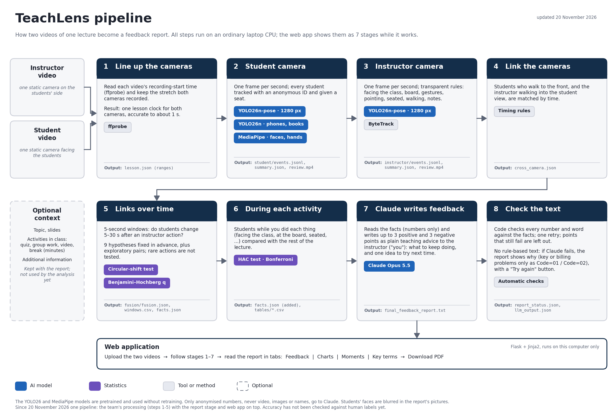

# Models used in TeachLens

This list contains only the models that the project's code actually runs (status 20 November 2026). Since that day
TeachLens is one pipeline: the team's lesson pipeline does the processing (`scripts/analyze_lesson.py`, `src/`), and
the report stage and web application sit on top of it (`scripts/report_lesson.py`, `web/`).

TeachLens is a hybrid system: pretrained deep-learning models detect people, body keypoints, faces, hands and
objects; transparent rules turn them into observable behaviours; statistical tests link instructor and student
behaviour; and a language model rewrites the feedback in plain English. No model was trained by the team.

## 1. Computer vision models (pretrained, used without retraining)

| Model | Type | Camera | Input | What it provides |
|---|---|---|---|---|
| **YOLO26n-pose** (`models/pose/yolo26n-pose.pt`, Ultralytics) | Person boxes + 17 body keypoints (COCO) | Both cameras, one frame per second | 1280 px | Positions, posture (sitting/standing), facing direction, gestures, pointing, hand raises, movement, seats |
| **ByteTrack** (with the team's track stitching) | Tracking algorithm (not a learned model) | Both cameras | – | Temporary anonymous track IDs that follow a person between frames |
| **YOLO26n** (`models/detection/yolo26n.pt`, Ultralytics, COCO classes) | Object detector | Student camera | 1920 px | Phones, laptops and books near a student's hands or in front of them |
| **MediaPipe Face Landmarker** (`face_landmarker.task`, Google) | 478 face landmarks + 52 expression scores | Student camera, faces 5 times per second | Face crops from the pose keypoints | Head direction, eyes closed, talking, smiling, yawning, nodding (facial actions) |
| **MediaPipe Gesture Recognizer** (`gesture_recognizer.task`, Google) | Hand landmarks + gesture classes | Student camera | Wrist crops | Open palm (a raised hand), thumbs up and other response gestures |

Behaviours such as "on task", "phone", "seated" or "hand raised" are not predicted by a model. They come from
transparent rules on the keypoints, landmarks and boxes these models return (docs/list_a_pose.md,
docs/list_c_students.md, docs/facial_actions.md). The rule thresholds are starting values that have not yet been
checked against human labels.

The report's two heatmaps also run YOLO26n-pose once on the single background frame of each chart, only to find
every person whose head must be blurred (including people the analysis did not track).

## 2. Language model

| Model | Use | Safeguards |
|---|---|---|
| **Claude Opus 5.5** (`claude-opus-5-5`, Anthropic; Sonnet 5.5 or Haiku 5.5 can be chosen by the deployment) | Reads the facts (numbers) and writes the positive and negative points in plain English for the instructor. Runs for every lecture; there is no rule-based text (user decision 20 November 2026: Claude writes the feedback; no rule-based text). | It receives only `facts.json`: anonymised numbers, never video, images, file names or names. Code checks every answer: numbers must come from the cited facts, points must cite facts of the right direction, no causal or inner-state words, no "because", no promises that an idea will work, and no talk about how the results were measured (plain teaching advice (user decision, 21 November 2026): a positive point says what went well and what to keep doing, a negative point says calmly what happened and offers one idea to try next time; no caveats about how the results were measured; those caveats stay in the saved files for the team). A point resting on a detection that a person checked and found unreliable is left out. One retry; then points that still fail a check after the retry are left out and the points that passed are shown (user decision, 21 November 2026); a side whose every point failed says so. Only when no point passes is there no feedback: the report gives the reason, and "Try again" re-runs only this step. About USD 0.04 per lecture, charged to the API account whose key the web app reads from the private `.env` file at start-up. |

The first real call was made on 21 November 2026 (about USD 0.05 for two attempts): the checks rejected both
answers, one of them for a number that was not in the facts; under the rule adopted the same day, its 3 passing
points (1 positive, 2 negative) are shown and the point with the invented number is left out (see implementation_testing_and_results_analysis.md,
2.2). The checks are also tested with simulated answers.

## 3. Statistical methods

| Method | Used for | Notes |
|---|---|---|
| **Lag correlation with a circular-shift test** | Do students change 5–30 s after an instructor action? (5-second windows) | The instructor's series is rotated in time; this keeps its rhythm but breaks its timing against the class. |
| **Benjamini–Hochberg q-values** | The 9 hypotheses fixed in advance, and the exploratory pairs, each corrected as a group | A link is a finding only if q ≤ 0.05. With many pairs and a short lesson, a single link cannot reach it. |
| **Lagged regression with Newey–West (HAC) errors** | Class value now vs instructor features a few windows earlier, controlling for the class value one window earlier | Allows for neighbouring windows being alike. |
| **Peri-event averages** | Rare actions (board, pointing, turning to the class): class value after each start vs before | Compared with random start times. |
| **Comparison during each activity (HAC, Bonferroni)** | Students while the instructor did one thing vs the rest of the lecture; the report's main feedback points and the comparison chart | A difference is "unlikely to be chance" only if p < 0.05 divided by the number of comparisons made; at least 5 windows on each side. |
| **Wilson interval** | Precision of each detection on the human review sheets | 95% interval. |
