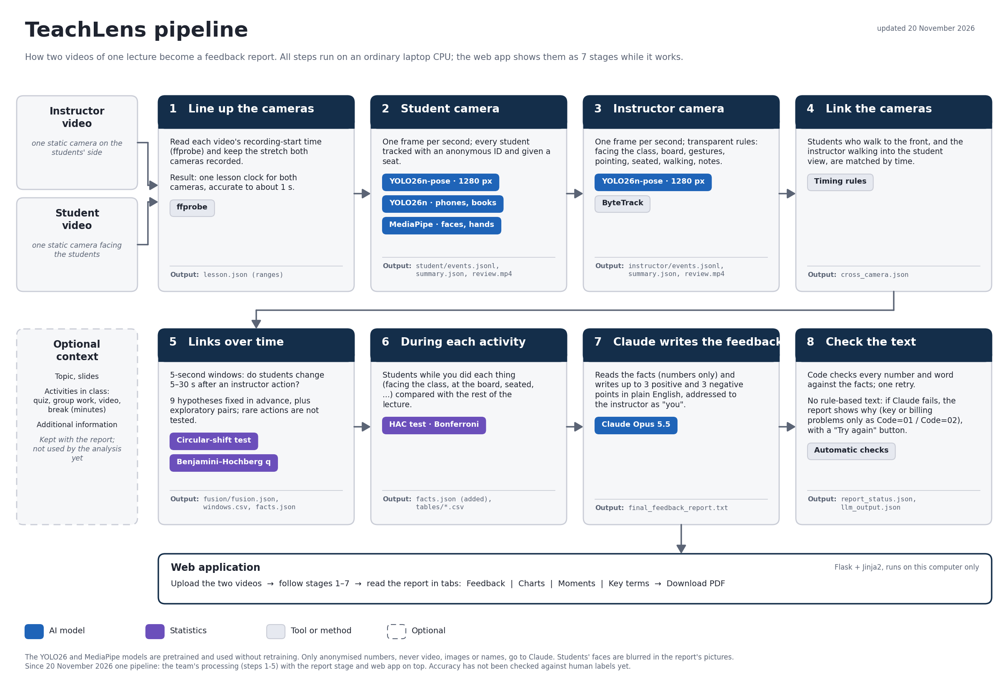

# System design and integration

*Figure: TeachLens pipeline (status 20 November 2026). Two recordings of one lecture are lined up by their recording
times; each camera is analysed by pretrained YOLO26 and MediaPipe models and transparent rules; the two cameras are
linked and the team's fusion layer tests links over time; the report stage compares students during each instructor
activity, writes plain-English feedback and has it rewritten by Claude under automatic checks; a local web
application shows the result. Drawn by `scripts/make_pipeline_diagram.py`.*

## 1. Design principles

1. **Evidence, then analysis, then reporting.** Each layer reads the saved output of the previous one. Models never
   write report text.
2. **Observable behaviour only.** Indicators describe what the camera sees ("on task", "facing the front"), never
   inner states ("attentive").
3. **Unknown is not zero.** Hidden or unreadable behaviour stays unknown and is left out of shares.
4. **Associations, not causes.** Statistics allow for neighbouring moments being alike and for multiple testing.
5. **Local and anonymous.** Video never leaves the computer. People are temporary track IDs and anonymous seats;
   students' faces are blurred in the report's pictures. Only anonymised numbers reach the language model.
6. **Rebuildable.** Every report can be regenerated from the saved lesson folder without processing the video again.

## 2. Architecture

One pipeline since 20 November 2026: the team's lesson pipeline (formerly "System A") does the processing; the report
stage and the web application (formerly part of "System B") sit on it. The rest of System B's own processing was
removed.

| Stage (web app) | Input | Processing | Output (`outputs/lessons/<date>_<lecture>/`) |
|---|---|---|---|
| 1. Line up the cameras | Instructor and student video | Recording-start time from each file (ffprobe); keep the stretch both cameras recorded | `lesson.json` (ranges) |
| 2. Student camera | Student video | One frame per second; YOLO26n-pose at 1280 px + ByteTrack (anonymous track IDs, stitching); seats learnt from seated shoulder positions; MediaPipe face landmarks (5 per second) and hand gestures; YOLO26n phone/laptop/book detector at 1920 px; rules (section 3) | `student/events.jsonl`, `summary.json`, `review.mp4`, `run.json` |
| 3. Instructor camera | Instructor video | One frame per second; YOLO26n-pose at 1280 px + ByteTrack; the camera's single person is the instructor; rules | `instructor/` (same files) |
| 4. Link the cameras | Both runs | Students who walk to the front, and the instructor walking into the student view, matched by time | `cross_camera.json` |
| 5. Lagged analysis | Both event files | 5-second windows on real time; lag correlation (5–30 s) with a circular-shift test; Benjamini–Hochberg over 9 fixed hypotheses and over exploratory pairs; comparisons with HAC; lagged models; peri-event averages; `facts.json` for the report | `fusion/fusion.json`, `windows.csv`, `links.csv`, `facts.json` |
| 6. Write the report | Windows, facts, events | Students during each instructor activity vs the rest (HAC, Bonferroni) added to `facts.json`; CSV tables | `facts.json`, `tables/events.csv`, `tables/activity_comparisons.csv` |
| 7. Claude writes the feedback | `facts.json` | Claude Opus 5.5 writes the positive and negative points for the instructor ("you"); code checks numbers and wording; one retry; on any failure no feedback is written and the reason is recorded (no rule-based text) | `final_feedback_report.txt`, `report_status.json`, `llm_output.json` |
| Web application | Two videos and optional context | Upload, progress by stage, tabbed report, delete | `outputs/uploads/<lecture>/`, `outputs/web_jobs/` |
| Human review (offline) | Lesson folder | Review sheets from the review videos; scoring | `outputs/validation/<lecture>/`, `facts.json` updated |

## 3. Behaviour rules (summary)

Rules work on body keypoints, face landmarks, hand gestures and object boxes; all thresholds are unvalidated starting
values. Full definitions: the team's docs (`docs/list_a_pose.md`, `docs/list_c_students.md`,
`docs/facial_actions.md`, `docs/fusion_lag_analysis.md`).

| Instructor (instructor camera) | Students (student camera) |
|---|---|
| Visible / presence | Number of visible students, seats |
| Facing the class, looking at the students, back to the class | Facing the front (on target) or away; looking down |
| Board or screen, writing on the board, pointing | Hand raised (open palm or a high wrist), answers after a raise |
| Gesturing, walking, standing still, path length | Phone (seen in the hand, or a long head-down), laptop, reading, writing |
| Seated (from the legs, or behind the desk from the shoulders' height), at the desk, reading notes | Talking, smiling, yawning, eyes closed / dozing posture, nodding |

A student is **on task** when facing the current focus (the front, or a classmate who answers), writing or reading,
and **off task** with a phone, a dozing posture, talking toward a neighbour, or facing away. Both are observable
proxies, not measures of attention.

## 4. Data design

| File | Contents |
|---|---|
| `student/events.jsonl`, `instructor/events.jsonl` | The evidence: one observation or interval per line (indicator, track, role, value, video and real start/end times, coverage) |
| `student/summary.json` | Totals per camera, seats (position, tracks, seconds on target / away / phone ...) |
| `fusion/windows.csv` | The lesson in 5-second windows: instructor `T_*` and student `S_*` features; empty = too little evidence |
| `fusion/fusion.json` | Lag analysis: hypotheses, links, models, peri-event results, findings |
| `facts.json` | Anonymised facts for the AI step (schema 1): direction, kind, numbers, evidence strength, glossary, which detections were checked by people |
| `tables/events.csv`, `tables/activity_comparisons.csv` | Both cameras' events as one table; every "during each activity" comparison |
| `final_feedback_report.txt`, `report_status.json` | The report text (AI or rules) and who wrote it, with the reason when the AI was not used |

## 5. Web application design (Model–View–Controller, Flask + Jinja2)

- **Models:**
  - `lecture.py`: uploads and lesson folders; checks the upload form (title, videos, activities in class).
  - `job.py`: runs `analyze_lesson.py` then `report_lesson.py` in the background, follows their output to show
    stages 1–7, records the AI result or why it was not used. Ultralytics is never allowed to download anything.
  - `report.py`, `stat_charts.py`, `charts.py`: report data, the two statistical charts, and the two heatmaps.
- **Upload form:** required: a lecture title and the two videos. Optional: "Additional context" (topic, slides) and
  "Activities in class" (quiz or test, group or pair work, video, break, each with its duration in minutes) followed
  by additional information. The optional context is stored and shown, not yet used by the analysis **[TODO]**.
- **Report page tabs:** Feedback (Claude's points, or the reason they are missing, shown as "Code=01" for an API key problem and "Code=02" for a billing problem, with a "Try again" button); Charts (the lecture
  timeline of students on task per 5 seconds, students during each of your activities with 95% ranges, Instructor
  Movement, Student Seats); Moments (hand raises, phones, dozing postures, with the seat and what you were doing);
  Key terms. A "Download PDF" button saves the whole report (all tabs, the blurred charts, a summary of the
  moments and the first 40 of them) as a document-style A4 `report.pdf` (report-sized type; no chart or table row is
  split across pages; the two statistical charts are redrawn for paper as a simple line chart and a grouped bar
  chart with values, and nothing that needs pointing or clicking is shown), printed by a hidden local browser (Edge or Chrome) from a
  self-contained copy of the page; nothing is downloaded or sent out, and the file is only made again when the
  report changes.
- **Privacy in the pictures:** both heatmaps are drawn on a frame of the uploaded video with every student's head
  pixelated: the people the analysis tracked, each seat's usual position, and anyone else the pose model finds in
  that frame. The instructor is not blurred (the report is theirs). If this fails, the chart is drawn without the
  frame, never over the unblurred picture. Seats used for less than a minute (someone passing the camera) are not
  drawn.
- **Security:** the server listens only on 127.0.0.1; chart files are served by exact name; a delete sent from
  another website is refused; instructors never handle API keys.

## 6. Integration

| Interface | How it is integrated | Status |
|---|---|---|
| Instructor camera ↔ student camera | Recording-start metadata; one real-time line | Done; about ±1 s |
| Team pipeline ↔ report stage | The report stage reads the lesson folder the team's pipeline writes (`facts.json`, `fusion/windows.csv`, events, summaries) and adds its facts to `facts.json` | Done 20 November 2026 |
| Pipeline ↔ web application | The web job runs the two commands and follows their output; the report page reads saved files only | Done; tested with made-up lessons and on a real lecture |
| Reporting ↔ language model | `facts.json` → Claude → checks → report; rules on any failure, with the reason shown | Implemented; first real call pending **[TODO]** |
| Human review ↔ report | Scores update `facts.json`'s indicator validation; the AI must then call a checked detection checked (or unreliable below 0.7 precision) | Implemented; no sheets filled yet **[TODO]** |
| Instructor's context ↔ analysis | Activities are stored with their duration but not when they happened | Stored and shown; not used **[TODO: decide]** |

## 7. Main design decisions

| Decision | Alternative | Reason |
|---|---|---|
| One pipeline: the team's processing with this report stage and web app (20 November 2026) | Keep two separate implementations | The team's pipeline measures more behaviours (faces, hands, seats, the desk); keeping one avoids two sets of results that disagree. |
| Two static cameras lined up by recording time | One camera; audio or clock syncing | One view rarely shows both sides; a moving view broke roles in an early test. Metadata gives about ±1 s without extra equipment. |
| Pretrained models with transparent rules | Training action models | No labelled classroom dataset; rules can be explained and tested. |
| One frame per second, 5-second windows | Every frame | CPU time on a laptop; the cameras are only aligned to about 1 s anyway. |
| Comparisons during each activity next to the lag analysis | The lag analysis alone | With many pairs in one lecture the lag analysis rarely passes its correction; the simpler comparison still gives the instructor checked, hedged points. |
| Claude writes the feedback, checked in code; no rule-based text (20 November 2026) | Rule-based text, or free AI text | Readable feedback that still traces every number to the facts; a failure is shown honestly with its reason and can be retried. |
| Fixed statistical settings; behaviour thresholds tuned later from human labels | Tuning everything on each lecture | Without labels there is no correct answer to tune towards; tuning the statistics on the data would produce false findings. |
| Blurred faces in every report picture | The raw frame, or no picture | The instructor still sees the room and the seats, but nobody can be recognised. |
| Local web application | Cloud hosting | Videos show real people. |
